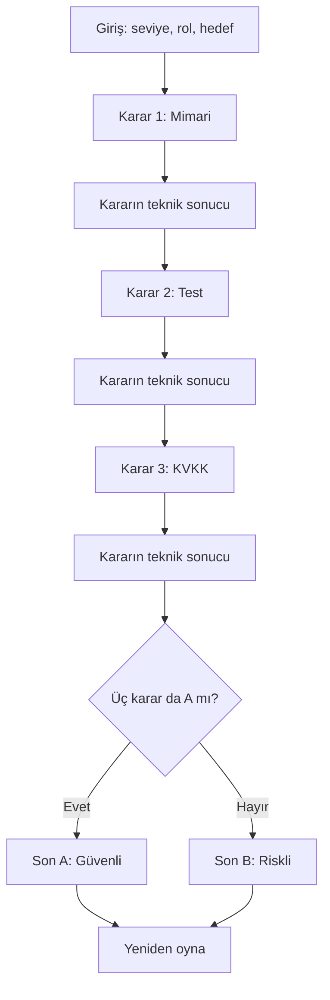

# SE Primer — Ürün Spesifikasyonu

## Problem
Yazılım mühendisliği öğrencileri kriz anında mimari, test ve kişisel veri kararlarının teknik sonuçlarını güvenli bir ortamda deneyimleyemiyor. SE Primer, tek bir sağlık bilişim senaryosunda üç kararın etkisini etkileşimli olarak öğretir.

## Kapsam
Mobil uyumlu web uygulaması; başlangıçta seviye, rol ve hedef seçimi; üç karar (mimari, test, KVKK); her karardan sonra sonuç ve gerekçe; Sokratik tutor; iki son; deneyimli kullanıcıda 60 saniyelik karar süresi.

## Kapsam dışı
Kullanıcı hesabı, ikinci bölüm, gerçek hasta verisi, native mobil uygulama, gerçek üretim sistemine erişim.

## Beş kabul örneği
1. **Yeni başlayan:** Seviye yeni başlayan seçildiğinde her karar ekranında ipucu gösterilir.
2. **Deneyimli:** Deneyimli seçildiğinde her kararda 60 saniyelik sayaç başlar; süre dolarsa riskli B kararı otomatik uygulanır.
3. **Açıklama:** Her A/B seçimi sonrası bir sonraki adıma geçmeden teknik sonuç ve gerekçe gösterilir.
4. **Güvenli son:** A-A-A dizisi güvenli toparlanma sonuna ulaşır.
5. **Riskli son:** A-A-A dışındaki yedi yol riskli toparlanma sonuna ulaşır; karar günlüğü görünür.

## Akış şeması

## Davranış ve sınırlar
Tutor, kullanıcıya doğrudan A/B yanıtı vermez; risk, kanıt ve doğrulama hakkında sorular sorar. Bu sürümde tutor serbest metni sınırlı anahtar kelimelerle sınıflandıran, deterministik Sokratik bir prototiptir; canlı üretken AI API bağlantısı yoktur. Uygulamada gerçek hasta bilgisi tutulmaz. 20 gerçek tutor cevabının izleri `docs/tutor-eval.md` dosyasındadır.
