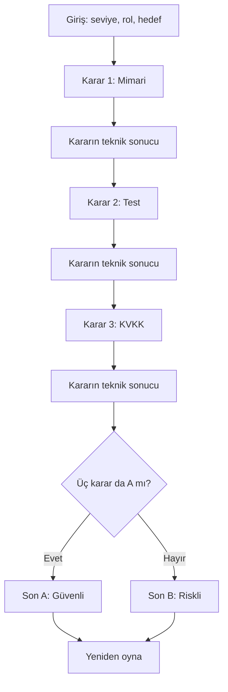

# SE Primer — Ürün Spesifikasyonu

## Problem
Yazılım mühendisliği öğrencileri kriz anında mimari, test ve kişisel veri kararlarının teknik sonuçlarını güvenli bir ortamda deneyimleyemiyor. SE Primer, tek bir sağlık bilişim senaryosunda üç kararın etkisini etkileşimli olarak öğretir.

## Kapsam
Mobil uyumlu web uygulaması; başlangıçta seviye, rol ve hedef seçimi; üç karar (mimari, test, KVKK); her karardan sonra sonuç ve gerekçe; Sokratik tutor; iki son; deneyimli kullanıcıda 60 saniyelik karar süresi.

## Kapsam dışı
Kullanıcı hesabı, ikinci bölüm, gerçek hasta verisi, native mobil uygulama, gerçek üretim sistemine erişim.

## Beş kabul örneği
1. **Yeni başlayan:** Seviye yeni başlayan seçildiğinde her karar ekranında ipucu gösterilir.
2. **Deneyimli:** Deneyimli seçildiğinde her kararda 60 saniyelik sayaç başlar; süre dolarsa riskli B kararı otomatik uygulanır.
3. **Açıklama:** Her A/B seçimi sonrası bir sonraki adıma geçmeden teknik sonuç ve gerekçe gösterilir.
4. **Güvenli son:** A-A-A dizisi güvenli toparlanma sonuna ulaşır.
5. **Riskli son:** A-A-A dışındaki yedi yol riskli toparlanma sonuna ulaşır; karar günlüğü görünür.

## Akış şeması

## v2 — Uyumlanan Primer: "Akış Modeli"

> Bu bölüm **eğitimden önce** yazılmıştır. Aşağıdaki eşikler model eğitildikten sonra değiştirilemez; değişirse gerekçesi `RELEASE.md`'de açıkça belgelenir. Kanıt: bu bölümün git commit'i, ilk `train.py` koşusundan öncedir.

### Model gereksinimi
- **Görev:** İkili sınıflandırma. Bir sahne ekrana gelmeden **önce**, oyuncunun o sahnede riskli **B** seçeceğini (süre dolup B'nin otomatik uygulanması dahil) tahmin eder. Çıktı: `p = P(B)`.
- **Neden:** Sabit kurallar (seviye = yeni başlayan → ipucu) herkese aynı davranır. Model, oyuncunun önceki sahnelerdeki **davranışından** öğrenip tutorun müdahalesini ayarlar: zorlanana destek, rahat olana meydan okuma.
- **Kapsam:** Model sahne 2 ve 3'te çalışır. Sahne 1'de geçmiş davranış yoktur; v1 davranışı aynen korunur.
- **Model:** `StandardScaler + LogisticRegression(random_state=13)`. Küçük, açıklanabilir, ONNX'e güvenle çevrilir. Çıkarım tarayıcıda (`onnxruntime-web`) çalışır; veri cihazdan çıkmaz.
- **Girdiler (sıra = `config.json` sözleşmesi):**
  1. `sahne_no` (2 veya 3)
  2. `seviye` (0 = yeni başlayan, 1 = deneyimli)
  3. `onceki_karar_suresi_sn`: önceki sahne ekrana geldikten seçime kadar geçen süre
  4. `onceki_okuma_suresi_sn`: önceki kararın teknik sonucunu okuyup "sonraki"ye basana kadar geçen süre
  5. `onceki_tutor_soru_sayisi`: önceki sahnede tutora sorulan soru sayısı
  6. `onceki_ipucu_acildi` (0/1)
  7. `onceki_b_sayisi`: şimdiye kadar seçilen B sayısı (0–2)
- **Etiket:** `secim_b` (0/1). Girdilerin hiçbiri bu sahnenin kendi davranışını içermez; bu yüzden etiket sızıntısı yoktur.
- **Oyunun davranışı (politika):**

  | p | Mod | Ne değişir |
  |---|---|---|
  | `p ≥ 0.60` | **destek** | İpucu otomatik açılır, tutor kendiliğinden bir Sokratik soru sorar, deneyimli olsa bile süre baskısı kalkar |
  | `0.25 < p < 0.60` | **normal** | v1 davranışı |
  | `p ≤ 0.25` | **meydan** | İpucu gizlenir (yeni başlayan olsa bile), sonuç ekranına "Neden?" derinlik notu eklenir |

  `0.60` ve `0.25` değerleri `config.json` içinde `esik_destek` ve `esik_meydan` olarak taşınır.
- **Güvenli geri düşüş:** Model yüklenemezse ya da hata verirse sahne **normal** modda ve v1 davranışıyla çalışır. Oyun asla modele bağımlı olarak kilitlenmez.

### Eval metriği ve kabul eşiği (altın standart) — ölçüm düzeni v2.1 ile değişti, aşağıya bakın
- **Doğrulama düzeni:** `GroupKFold(n_splits=5)`, grup = `oturum_id`. Aynı oturumun satırları hem eğitimde hem testte olamaz. **Başarı yalnız `kaynak = gercek` satırlarında ölçülür**; sentetik satırlar yalnız eğitim katlarında kullanılır (sentetik veriyi üreten kural kolay öğrenildiği için ölçümü şişirir).
- **Birincil metrik:** ROC-AUC (5 katın ortalaması) **≥ 0.70**. Bir test katında yalnız tek sınıf varsa o katın AUC'si tanımsızdır, ortalamaya girmez; en az 3 geçerli kat gerekir. (Açıklama: eşik değeri değil, ölçüm tanımı; az veride bu durum kaçınılmazdır.)
- **İkincil metrik:** Brier skoru, "her zaman eğitim sıklığını tahmin et" tabanından **daha düşük** olmalı.
- **Mühendislik kapıları:**
  - ONNX ile sklearn arasındaki en büyük olasılık farkı **≤ 1e-4**.
  - `train.py` aynı tohumla iki ayrı koşuda **birebir aynı** metrikleri üretir.
  - Değerlendirmede en az **15 gerçek oturum** bulunmalıdır; yoksa betik hata verir.
- **Kapı:** Herhangi biri sağlanmazsa `train.py` sıfırdan farklı çıkış koduyla durur ve `model/` altına artefakt **yazılmaz**. Yayınlanmaz.

### v2.1 — İlk deneme başarısız oldu; ölçüm düzeni değişti (4 Kasım 2026, ikinci veri turundan ve yeniden eğitimden ÖNCE)

**Ne oldu.** Yukarıdaki kapıyla (GroupKFold(5), eğitim katlarında 300 sentetik satır) ilk gerçek veri turu (3 kişi × 5 oturum = 15 oturum, 30 modele girebilen satır) koşuldu ve kapı **geçilemedi**: AUC **0.4533** (eşik 0.70), Brier **0.2638** (taban 0.2511). `model/` yazılmadı. Çıktı `RELEASE.md`'de saklanır.

**Neden (gözlem, kanıt değil).** (a) Gerçek oyuncular sahneleri hızlı tıklayarak geçti (karar süresi medyanı 1.2 sn, okuma 0.7 sn); tutor sorusu ve ipucu girdileri sabit 0. (b) Sentetik üreticinin varsayımı ("uzun düşünen B seçer") gerçek veriyle ters yönde çıktı; 300 sentetik satır 30 gerçek satırı bastırıp modeli yanlış yöne çekti.

**Değişmeyenler (eşikler).** ROC-AUC ≥ **0.70**; Brier < taban; ONNX farkı ≤ 1e-4; aynı tohumla birebir tekrarlanabilirlik; en az **15 gerçek oturum**; tohum 13; model ailesi (`StandardScaler + LogisticRegression`), 7 girdi ve politika eşikleri (0.60 / 0.25). Hiçbir eşik gevşetilmedi.

**Değişenler (ölçüm düzeni).**
1. **Sentetik satırlar artık eğitime girmez.** Yalnız gerçek oturumlar. Sentetik veri yalnız boru hattını sınamak için (`--deneme`) kalır. Gerekçe: yönü gerçek veriye zıt çıktı; modele öğrenmediği bir kuralı öğretiyor.
2. **Kapı ayrı kişilerden gelen tutulan (holdout) bir sette ölçülür.** Birinci tur (`data/oturumlar.csv`, `gercek` satırları) **geliştirme seti**dir: ilk sonucu gördük, üzerinde hata ayıkladık. İkinci tur (`data/dogrulama.csv`) **yeni kişilerden en az 15 oturum**dur; birinci turdaki kişilerden hiçbiri bu sette olmaz. Model yalnız geliştirme setinde eğitilir, kapı **yalnız doğrulama setinde** ölçülür: havuzlanmış ROC-AUC ≥ 0.70 ve Brier < geliştirme setinin B oranını tahmin eden taban. Doğrulama setinde en az **15 oturum** ve her iki sınıf bulunmalıdır.
3. Kapı geçilirse yayınlanan model, iki turun tüm gerçek satırlarıyla yeniden eğitilir (kapıyı geçen aynı tarif, daha çok veri). Kapı sonucu yine yalnız doğrulama setinden raporlanır.
4. Oturum kimlikleri iki sette ayrık olmalıdır (`tools/birlestir.py` aynı kimliği iki sette reddeder).

**Ön kayıt (sonucu görmeden).**
- Doğrulama seti **tek kullanımlıktır**: sonucu gördükten sonra özellik, model, eşik ya da veri politikası değiştirilip aynı sette yeniden denenmez. Kapı geçilemezse model yayınlanmaz; başarısızlık ve nedenleri `RELEASE.md` ve `README.md`'de olduğu gibi anlatılır.
- Doğrulama setinden etikete ya da model çıktısına bakılarak oturum **çıkarılmaz**. Tek dışlama: üç sahnenin tamamı kaydedilmemiş (eksik) oturumlar.
- Veri toplama yönergesi ikinci tur kişilerine verilir: senaryoyu gerçekten oku, normal hızında karar ver, merak için diğer seçeneği seçme; ipucu ve tutor isteğe bağlı. Kişi başı en fazla **2 oturum**, en az 8 kişi.

### v2.2 — Zaman yetmedi: doğrulama seti 15 oturuma ulaşmadı (4 Kasım 2026 akşamı, `train.py` doğrulama setinde HİÇ koşulmadan ÖNCE)

**Durum.** İkinci turdan yalnız 3 oturum (6 modele girebilen satır) geldi; teslim 6 Kasım. Bu kadar satırda holdout AUC'si anlamsızdır. Ürün sahibi (Merve) elde olanla ilerlenmesini istedi.

**Karar.** Eşikler yine değişmez: ROC-AUC ≥ 0.70, Brier < taban, ONNX ≤ 1e-4, **toplam en az 15 gerçek oturum** (elimizde 15 + 3 = 18). Ölçüm düzeni `--olcum cv` olur: iki turun **yalnız gerçek** oturumları havuzlanır, `GroupKFold(5)` (grup = oturum), sentetik yok. Yayınlanan model aynı satırlarla eğitilir.

**Dürüst sınırlar (model kartına ve README'ye yazılır).**
- Bu, bağımsız bir doğrulama **değildir**: birinci tur verisi için sonucu zaten gördük (v2.0 başarısızlığı, keşifsel gerçek-yalnız AUC 0.785), ölçüm düzenini sonradan seçiyoruz. Sonuç optimistik olabilir; güven aralığı raporlanır.
- 36 satırlık örneklem küçüktür; sonuç kanıt değil, yalnız bir ön gösterge sayılır.
- Kapı geçilemezse model yayınlanmaz.

### Üç yeni kabul örneği (v2)
6. **Destek:** Model `p = 0.72` döndürdüğünde (deneyimli oyuncu, sahne 2) ipucu otomatik görünür, tutor kendiliğinden bir soru sorar ve sayaç görünmez. Mod göstergesi `destek` yazar.
7. **Meydan:** Model `p = 0.10` döndürdüğünde (yeni başlayan oyuncu, sahne 3) ipucu gösterilmez ve sonuç ekranında "Neden?" notu çıkar. Mod göstergesi `meydan` yazar.
8. **Geri uyumluluk ve parite:** Sahne 1'de ve model yüklenemediğinde v1'in beş kabul örneği ile sekiz karar yolu aynen geçer. Beş referans girdi için tarayıcıdaki olasılık (`data-cy="p"`) ile Python referansı (`tests/parite.py`) arasındaki fark **< 1e-4** olur.

### Toplanan veri ve gizlilik
Yalnız yukarıdaki sayısal davranış alanları, `sahne_no`, `secim`, `sure_doldu`, rastgele üretilmiş `oturum_id` ve `kaynak` saklanır. Ad, e-posta, cihaz kimliği, konum, IP ve serbest metin (tutora yazılanlar dahil) **toplanmaz**.

## Davranış ve sınırlar
Tutor, kullanıcıya doğrudan A/B yanıtı vermez; risk, kanıt ve doğrulama hakkında sorular sorar. Bu sürümde tutor serbest metni sınırlı anahtar kelimelerle sınıflandıran, deterministik Sokratik bir prototiptir; canlı üretken AI API bağlantısı yoktur. Uygulamada gerçek hasta bilgisi tutulmaz. 20 gerçek tutor cevabının izleri `docs/tutor-eval.md` dosyasındadır.
